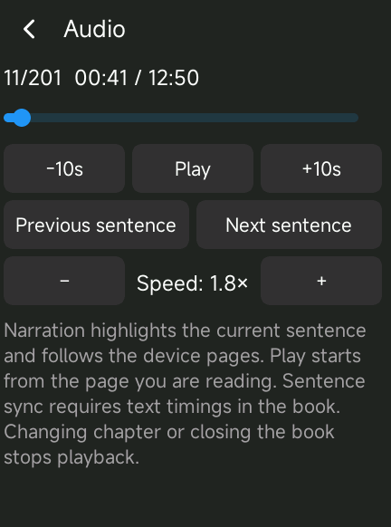

# EPUB embedded audio

Open a book from **Ebooks**. Chapters containing audio show an **Audio** bar
above the reading status strip. Press its play/pause button to listen while
reading; tap **Audio** for the seek slider, ten-second skips and previous/next
sentence controls (passages for inline audio). The reader menu also contains
an Audio panel.

Supported content:

- Local XHTML `<audio src>` and nested `<source>` alternatives.
- EPUB 3 manifest `media-overlay` associations and SMIL `audio` timings.
- Full/partial SMIL clocks, fractional seconds, `npt=`, and h/min/s/ms timecounts.
- Adjacent narration sentences in one resource become one seekable passage.
- MP3, AAC/MP4, ADTS AAC, Vorbis, Opus, FLAC, WAV and WavPack resources,
  subject to the codecs available in the player build. Manifest MIME types
  identify resources without filename extensions.

Playback starts only when requested. The reader remembers passage and audio
position per book in `ebook_config.ini`. Manually changing chapters or closing
the book stops playback. Narration continues automatically into the next
chapter when that chapter has audio. The hardware play/pause and skip controls
operate on ebook audio
while the reader owns the output. Narration does not replace the music queue,
auto-advance into music or become a remembered temporary music file.

Authored SMIL text/audio pairs highlight the active sentence. The reader follows
its actual reflowed device pages, including sentences spanning a page boundary.
Play after opening or manually turning a page seeks to that page's text rather
than the chapter beginning. Previous/Next sentence navigate the authored pairs
without reopening a shared audio resource. Inline audio without SMIL text timings
remains playable but cannot provide sentence synchronization or page seeking.

Audio settings offer pitch-preserving 0.5×–3.0× playback in 0.1× steps, remembered
between books and restarts. The seek slider covers a continuous audio passage.
The sync clock accounts for audio queued in ALSA rather than following decoded
samples ahead of the sound. The reader checks it every 100 ms, repainting text
only when the highlighted range changes. This is not sample-accurate sync.

Timing precision follows the book's authored units. With sentence-level timings,
the exact time of a word halfway through a sentence is unavailable: seeking to a
page beginning mid-sentence and following that sentence across pages interpolate
within its time range. Paragraph-level overlays highlight paragraphs. JavaScript,
remote media, DRM and full EPUB 3 conformance remain unsupported.

## Resource use

The reader extracts one resource at a time to a private `.ebook-audio-*`
directory on the SD card, on a worker thread. Extraction uses 32 KiB input
and output buffers, verifies the resource's CRC and checks available disk space.
An individual resource may be up to 1 GiB. ZIP64/encrypted archives are not
supported. Preparing a large resource takes time; the interface remains usable.
Partial files are deleted on failure/cancellation. One disk resource can be
reused across chapters of the same book and is deleted when the book closes.
An abrupt loss of power may leave a hidden cache directory, which can be
deleted when the reader is closed.

SMIL documents are parsed in a temporary arena released immediately afterward;
only chapter playback metadata is retained. The temporary fragment hash index
is freed after matching normalized XHTML text; no DOM or chapter-wide highlight
widgets are retained. Sentence cues use 32 bytes each on the R1, allocated to the
actual chapter's cue count, with a limit of 8192. Audio paths are shared. The
visible page uses the existing span renderer with a small draw-task identity
compatibility patch generated at build time, leaving the LVGL checkout untouched.
The paged modes retain one screenful of objects (two during a slide); the existing
vertical scrolling mode still creates the chapter's blocks. Up to 8192 disjoint
passages per chapter are accepted. The allocator's headers are padded to
maintain eight-byte alignment on 32-bit MIPS as well as 64-bit hosts.

## Tests

From `sonix-player/`:

```sh
python3 tools/test_epub_audio.py --sanitize
```

The bench compiles the actual parser, ZIP extraction code, config store and
playback controller against a deterministic audio backend. It covers inline
sources, URI decoding, MIME-only resources, overlays, merged sentences,
invalid timings/resources, clip limits, stored/deflated ZIP members, CRC errors,
truncation, cancellation, destination protection, preparation-time pause,
seeking, discontinuous passages, completion, resume and output takeover.

`--fixtures DIR` retains the generated synthetic books. The C bench can be
cross-compiled and run against those books on the player; keep assertions
enabled. `tools/inspect_epub_audio.c` is a read-only probe for checking every
chapter of a real EPUB directly on the player. Neither probe replaces the
installed player or verifies audible playback through ALSA.

## Build and deployment notes

The normal Linux/Rockbox workflow remains `make target`; application sources
are discovered automatically. A macOS cross-build was also validated using
Zig 0.13.0 targeting `mipsel-linux-gnueabihf.2.22`, the project's pinned static
FreeType/audio libraries, and the device's ALSA shared library. The repository's
glibc 2.22 ABI check passed. Two missing direct standard-header includes in
streaming pages and one in USB handling were made explicit after removing an
unused ALSA dependency from the audio API header.

Validation includes native AddressSanitizer/UndefinedBehaviorSanitizer tests,
the same standalone parser/controller bench cross-compiled for the R1, and
interactive playback on a physical R1. Sentence highlighting, automatic page
turns, sentence navigation, speed changes, and persisted settings were confirmed
on that device. Four real narrated books resolved all 79,979 SMIL text targets;
their retained book/chapter arenas peaked at 448 KiB. A synthetic chapter with
4,000 cues retained 832 KiB of arenas on the R1. The reader process used about
19 MiB resident memory in the observed session; that figure is not a worst-case
bound for all books, fonts or codecs. Physical R3 Pro II and full simulator
validation remain pending.



Streaming service sealing keys are not in the public source; custom builds
need their own credentials to use the existing streaming services.
